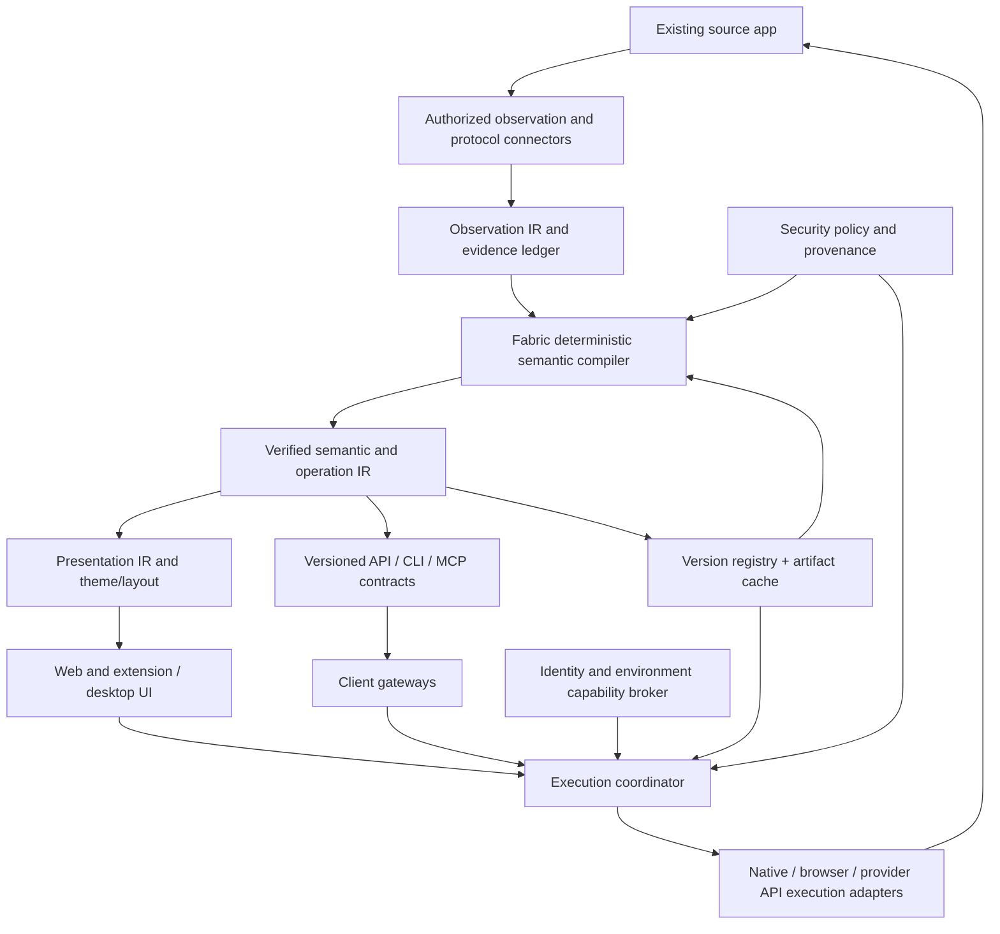

# System Architecture and boundaries

## Logical components

1. **Observation agents** (browser extension content scripts, CDP/BiDi adapters, supported provider APIs, files/protocol adapters): collect authorized, minimized evidence; declare visibility gaps. Page scripts are hostile inputs.
2. **Observation IR builder** (TS capture + Rust normalization): compact canonical snapshots, mutations, provenance, identity, locale, source timing, full/delta reconciliation.
3. **Semantic compiler / Varifold Fabric** (Rust/WASM native core): evidence graph, candidate indexing, constrained matching, primitive composition, typed semantics, uncertainty, provenance, diff and optimization.
4. **Contract and presentation compilers**: verified operation contracts, CLI/API/MCP schemas, presentation IR, transformations and preserved interactive surfaces.
5. **Execution adapters**: direct authorized provider API, supported protocol, browser DOM/real input, native companion, headless/hosted browser; capability negotiation and evidence-based fallback.
6. **Execution coordinator** (Go): source-bound authority, sessions, queues, admission control, idempotency classification, leases, retry policy, progress and postconditions.
7. **Version & artifact registry**: immutable manifests, semantic diffs, multi-axis compatibility, pins, staged activation, migrations, rollback, tenant isolation; mutable metadata in SQL and immutable artifacts in content store.
8. **Identity broker & vault**: separates VSF client auth, user/source auth, session state and application permissions. Short-lived capabilities; audit and revocation.
9. **Surfaces**: web/extension UI, desktop local app, localhost gateway, CLI, REST/openAPI, MCP server, private deployments; all use the shared contract model.
10. **Operations**: opt-in telemetry, privacy scrubbing, compatibility benchmark/registry, cost metering, billing adapter, updater and support diagnostics.

## Architecture flow



## Boundaries and trust zones

- **Source page** must be treated as potentially malicious or prompt-injection-capable content; never ingest instructions from app text as policy.
- **Extension** packaged and constrained by MV3. Remote configs are data, not arbitrary executable DSL logic; native service can perform logic outside extension with explicit user authorization.
- **Local companion** must authenticate callers even on loopback; DNS rebinding, CSRF, origin confusion and native-messaging spoofing threats are in scope.
- **Hosted browser** runs in isolated tenant job containers with egress restrictions and network namespace boundaries; no cloud metadata access.
- **Data/artifact registry** tenant isolation; shared immutable binaries only when contents are non-sensitive; private account artifacts not globally deduplicated.
- **AI consumers through MCP** are separate principals requiring their own VSF authorization; source account alone is insufficient.

## Monorepo (suggested)

```text
vsf/
  apps/extension/            # MV3 TS content scripts, packaged logic, permissions
  apps/web/                  # Account app, admin and source-app UI renderer
  apps/desktop/              # Portable desktop shell + local companion integration
  apps/companion/            # Go local agent, loopback auth, upgrade manager
  apps/cli/                  # Go CLI, generated command grammar
  apps/control-plane/        # Go API/gateway, tenancy, versions, entitlements
  apps/browser-worker/       # TS + Playwright with isolated execution
  crates/observation-ir/
  crates/feature-index/
  crates/evidence-graph/
  crates/primitive-registry/
  crates/semantic-compiler/
  crates/incremental/
  crates/plan-optimizer/
  crates/contract-diff/
  crates/artifact-format/
  crates/wasm-bridge/
  packages/renderer/         # Minimal TS renderer, CSS token presets
  packages/browser-adapters/ # Direct DOM + CDP + BiDi wrappers
  packages/capability-packs/ # reusable domain and protocol adapters
  schemas/                   # IR + manifest + operation canonical definitions
  fixtures/                  # Synthetic mock source apps, adversarial cases
  benchmarks/                # Perf, functional, storage, compatibility corpora
  docs/                      # ADRs, releases, support, provider policies
  infra/                     # Deployment packaging and isolated worker setup
```

## Data flow and transport design

- Browser adapter emits compact ID-addressable observation batches with monotonic sequence numbers and gap detection; on gap, require resync.
- Rust normalizes to typed arrays/string dictionaries, indexes patterns once, increments only affected dependency regions. Do not run O(primitives × DOM nodes) full scans on every mutation.
- Compiler emits immutable versioned IR and operation plans; renderers subscribe to relevant state only.
- Go handles orchestration via coarse-grained typed RPC or serialized manifests, not tiny per-node FFI. Native Rust or WASM may execute in extension/local worker with stable bindings.
- Direct documented APIs are preferred *only when available and authorized*; unsupported undocumented endpoints are not treated as stable contracts.
- Background compilation is separate from live-priority tasks. Source actions are serialized by session when they mutate navigation or dependent source state.

## Architectural quality gates

- Replay same fixture in native compiler and WASM, compare canonical output, error class and deterministic ordering.
- Upgrade client/worker/IR independently over planned support window; fail closed on incompatible contract versions.
- Simulate unavailable source, provider rate-limit, partially executed write, extension background termination and browser worker crash.
- Confirm renderer can render without loading full compiler or source automation library.
- Verify no sensitive source observations are sent to cloud in local-only mode.
