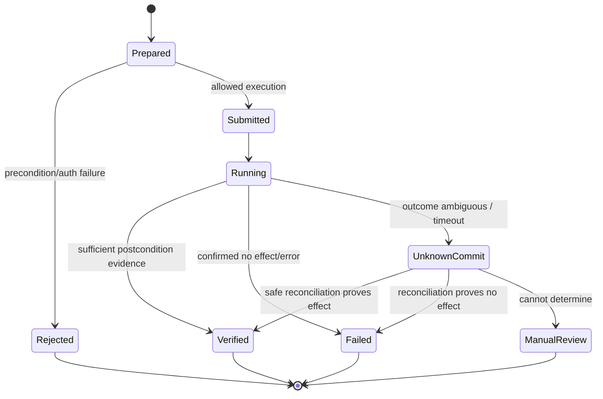

# Canonical contracts and intermediate representations

**Architectural requirement:** Schema and contract design precedes mass primitive implementation. The compiler needs a clear type system for uncertainty, effect and identity. Typed models belong in one schema source, with Rust/Go/TS bindings generated and compatibility tested.

## Six distinct records

1. **EnvironmentCapabilityManifest**: what this specific runtime can observe, execute and persist under current user permissions.
2. **ObservationIR**: observed DOM/accessibility/layout/network/protocol evidence, source origin, timestamp, freshness, scope and missing signals.
3. **SemanticIR**: typed entities, fields, relationships, actions, effects, state machines, units, evidence/provenance and uncertainty.
4. **OperationContract**: stable method ID, input/output schema, authority/effect classification, execution strategies, freshness/verification, version and deprecation.
5. **PresentationIR**: constraints, semantic grouping, visual component composition, editable layout and accessibility mappings.
6. **VersionManifest**: cryptographic digest tree, compilation environment, compatibility axes, migration edges, tier retention/immutability and signed promotion record.

## Typed identifiers

`source_app_id` (provider + origin/installation identity); `source_variant_id` (tenant/configuration, accessible feature set and locale); `principal_ref` (user-scoped opaque identifier); `runtime_id`; `compiler_version`; `ir_schema_version`; `primitive_set_digest`; `contract_version`; `presentation_version`; `artifact_digest`; `observation_epoch`; `auth_session_ref`; `effect_id`; `operation_id`.

Never include raw tokens, secrets or PII in stable public artifact IDs. Identity fingerprints use well-defined scope and, where necessary, secret-keyed hashing within tenant boundaries.

## Example operation contract (design sketch)

```yaml
contract_schema: 1
operation_id: app.records.update_stage
contract_version: 1.3.0
source:
  app_id: vendor-console
  variant_class: tenant_role_profile_hash
  capabilities: [read_record, edit_record, verify_record]
inputs:
  record_id: {type: string, required: true}
  stage: {type: enum, values: [qualified, proposal, won]}
outputs:
  record: {type: object, typed_ref: RecordV1}
effect:
  class: reversible_write
  idempotency: conditional
  confirmation: inherit_source_requirement
  concurrency_scope: source_session_and_record
freshness:
  before_write: source_read_required
verification:
  required: true
  strategy: read_back_field
strategies:
  - provider_api_authorized
  - verified_browser_plan
provenance:
  evidence_refs: [evidence_batch_001, source_schema_003]
  verifier_suite: ops_update_stage_v2
on_ambiguity: report_unknown_no_auto_retry
lifecycle: active
```

The example makes **no** claim that a particular provider supports this operation. It illustrates the shape of an already verified contract.

## Evidence model

Evidence has a type (`observed_structure`, `runtime_behavior`, `documented_schema`, `protocol_trace`, `source_accessibility`, `user_assertion`, `heuristic_inference`), a witness, timestamp, authorizing context and structural dependency. A declaration must explicitly state supported *claims*, not a single scalar 'confidence' that can mask missing proof. Contradictions lead to `UNKNOWN` or `CONFLICTED`, never arbitrary precedence for write semantics.

## Operation status state machine



Do not retry `UnknownCommit` blindly. Retrying requires an explicit idempotency key, source confirmation or demonstrated compensating behavior.

## Source authority and authorization

Each execution binds `VSF caller principal` + `VSF entitlement` + `source principal/session` + `source effective scope` + `environment manifest` + `operation contract`. Authorization is checked at execution time, not frozen in globally cached interface artifacts.

## Structural/semantic equivalence

- Structural equivalence: nodes/relationships map under typed rules.
- Behavioral equivalence: operation effect and observable constraints agree across environments.
- Presentation equivalence: required information and interactions preserved, not visual pixel equality.
- Programmable equivalence: generated method schema faithfully represents validated operation including partial failure and long-running semantics.

## Schema evolution discipline

- IR schema major/minor is independent of contract semantic version.
- Additive fields: defaulting/unknown handling specified; validators must not accidentally treat absent safety fields as safe.
- Breaking schema changes: migration and fixture golden files mandatory.
- Canonical serialization: stable key ordering, numeric/decimal semantics, Unicode normalization policy, timezone encoding, NaN rules, no ambient locale dependence.
- Data migration is forward-only unless a reversible migration is explicitly validated; artifact rollback and mutable state rollback are different operations.

## Example invariants for test generation

- Cross-principal cache hit never produces authority to execute.
- A stale observation epoch cannot authorize a state-changing operation requiring fresh proof.
- Contract version pin cannot reanimate source-removed behavior.
- Changing presentation has no effect on operation authorization, effect or source semantics.
- Native and WASM semantic compiler share canonical output or explicitly document platform-induced differences.
