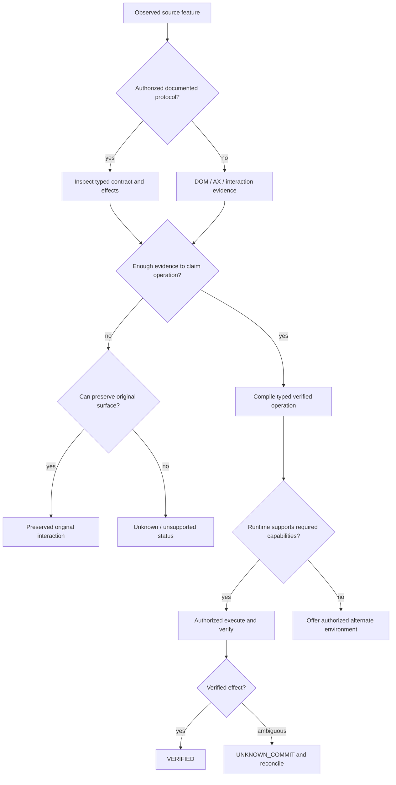

# Risks, kill criteria and decision tree

## High impact risks

| ID | Risk | Leading signal | Preventive architecture | Response |
|---|---|---|---|---|
| R01 | Semantic ambiguity / wrong operation | high UNKNOWN / incorrect target binding | evidence graph, negative fixtures, source-state verification | restrict semantic API; preserve original surface |
| R02 | Overbroad extension permissions/rejection | MV3 policy conflict or store rejection | packaged interpretation, reviewable data contracts | move to native companion; change extension scope |
| R03 | Auth exposure / untrusted localhost | source auth accessible from webpage | paired caller, origin checks, vault | stop local gateway release |
| R04 | Cross-tenant cache contamination | sensitive node in shared artifact | classification, scoped CAS and signing | quarantine cache, rotate keys, incident response |
| R05 | Source app frequent drift | repeated failed pins | variant fingerprints, semantic diff, repair | degrade/pause source capability, partner API where possible |
| R06 | Race/double write | timeouts create inconsistent state | unknown-commit lifecycle, source constraints | conservative retry policy and audit |
| R07 | Long-tail specialist UI costly | low coverage uplift per pack | composable primitives, preserved surfaces | re-prioritize failure clusters |
| R08 | Renderer grows into bespoke framework | heavy upkeep / regressions | small core, mature specialist libs | buy-vs-build evidence review |
| R09 | Performance stalls | 30s basic operation | incremental indexes, cached plans, trace decomposition | block release, profile and refactor algorithms |
| R10 | Hosted sandbox abuse | SSRF, expensive infinite sessions | network isolation, budgets, idle stop | quarantine/stop jobs and patch |
| R11 | ZEROS3 hidden overhead | worse p95/RSS under small objects | storage abstraction & baseline | use SQLite/filesystem for hot/small objects |
| R12 | Premium version promises unsustainable | source removes feature while pin active | lifecycle status and compatibility expiry | report unsupported, offer migration, never invent |
| R13 | Billing/payments inflexibility | country/tax/provider mismatch | payment-agnostic adapter, usage ledger | select new provider or manual invoicing |
| R14 | Poor actual willingness to pay | pilots prefer native CLI/console | UX metrics and narrow beachhead | pivot positioning/segment |
| R15 | Too many modes before reliable core | six inconsistent runtimes | shared contract/capability negotiation | stagger mode maturity without dropping architecture |
| R16 | Enterprise compliance complexity | procurement stops deployment | local/private modes, audit and data controls | restrict sensitive markets until ready |
| R17 | Third-party terms/distribution conflict | explicit provider restriction | provider policy registry and documented API path | seek agreement or do not support prohibited usage |
| R18 | Version storage exceeds budget | retention growth, pinned GC roots | content addressing, tiered paid retention | quotas, upgrades, explicit archival pricing |

## Program stop rules

- **Stop** any release path with an unauthorized source write, false VERIFIED state on a known ambiguous write, leaked credential/tenant data or known compromise of signed execution artifacts.
- **Hold** hosted/private deployment if network isolation, key isolation, cost cap or revocation tests fail.
- **Revise** core abstraction if held-out primitive fixes do not transfer across unrelated applications.
- **Narrow** claims and/or market if broad 99% goal remains unmeasurable rather than quote a misleading percentage.
- **Choose** a simpler execution or persistence backend if profiling proves added complexity offers no benefit.

## Decision tree

